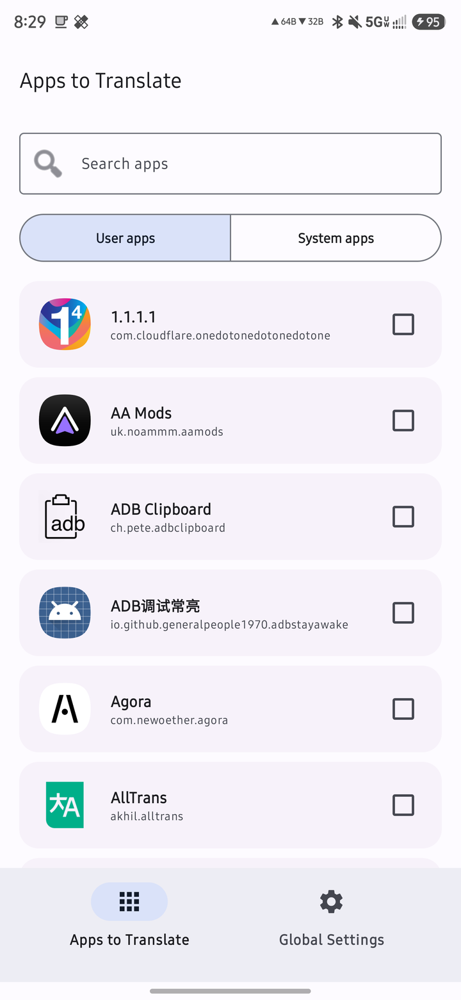
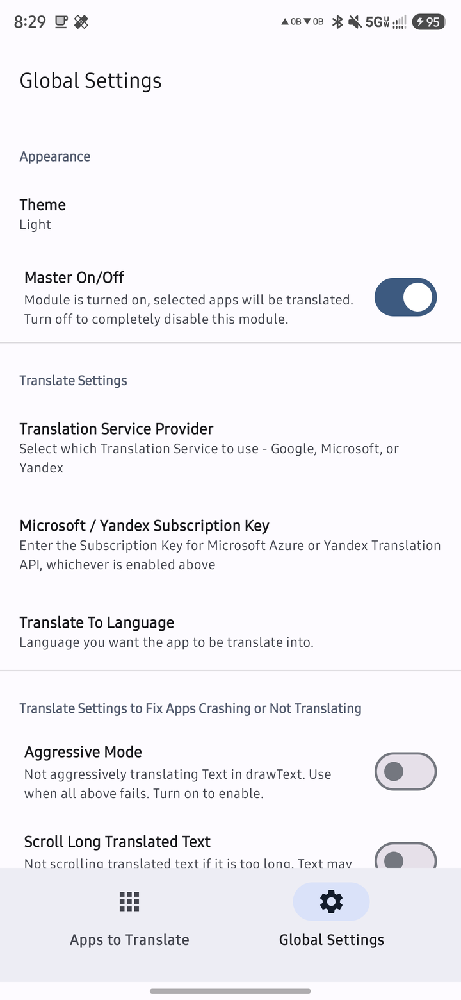
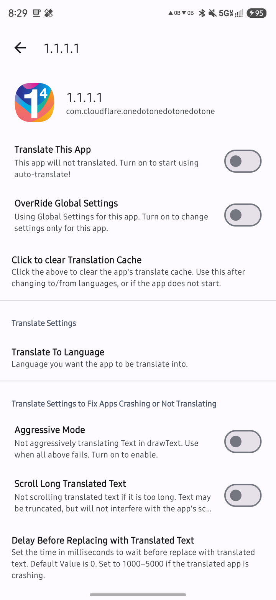

<p align="center">
  
</p>

# AllTrans Next

**AllTrans Next** translates **all text inside an app** from one language to another at runtime -
like Chrome's page translation, but for Android apps. It works through LSPosed/Xposed, so it
replaces text, hints, notifications, web views and drawn text directly in the target app.

> **AllTrans Next** is the successor of the original **AllTrans** Xposed module created by
> [Akhil Kedia](https://github.com/akhilkedia). It is a separate project with a new package name
> (`akhil.alltrans.next`) and a Material 3 UI, so it can be installed side-by-side with the
> original AllTrans. This repository is maintained by
> [@rushiranpise](https://github.com/rushiranpise).

[](https://www.gnu.org/licenses/gpl-3.0)

[](https://buymeacoffee.com/rushiranpise)

Download the latest APK from the [GitHub releases](https://github.com/rushiranpise/AllTrans-Next/releases).

## Features

- Translates **all text in an app** at runtime: `TextView`, hints, notifications, web views and
  canvas-drawn text.
- **Per-app enablement** with an app picker that separates user and system apps and includes a
  search field.
- **Material 3 interface** with bottom navigation, dynamic color (Material You) on Android 12+,
  and light, dark and AMOLED black themes.
- **Google ML Kit translation** works offline after the model download (~30-60 MB per language
  pair). No API key needed.
- Optional **Microsoft** or **Yandex** translation with your own subscription key.
- Per-app overrides for language pair, aggressive mode, delays, caching and notifications.
- Works with **LSPosed** (and EdXposed) on rooted devices, and with VirtualXposed/Taichi.
- 16 KB page-size compatible ML Kit native libraries on Android 15+.

## Requirements

- Android **5.0 (API 21)** or newer. Tested on Android 15 and 16 (targetSdk 35).
- An Xposed-compatible framework: [LSPosed](https://github.com/LSPosed/LSPosed) is recommended.

## Installation

1. Download the latest APK from the [releases page](https://github.com/rushiranpise/AllTrans-Next/releases).
2. Install it. The package is `akhil.alltrans.next`, so it can coexist with the original AllTrans.
3. Open **LSPosed** and enable the **AllTrans Next** module (it appears as a new module, separate
   from the original AllTrans).
4. Add these to the module's scope:
   - **System Framework** (`android`)
   - **Settings Storage** (`com.android.providers.settings`)
   - the apps you want to translate
5. Reboot the phone.

## Usage

1. Open **AllTrans Next** and pick the **Translate From** and **Translate To** languages.
2. On the **Apps to Translate** screen, find the app and switch it on. Use the **User apps** and
   **System apps** buttons to filter the list.
3. Tap an app to open its settings if you need a per-app language pair or a different delay.
4. Force-stop and reopen the target app - its text is translated.

## Translation providers

- **Google (default)** - uses ML Kit, works offline after the model is downloaded, no key needed.
- **Microsoft** - requires a free Azure Translator key. Create a *Translator* resource with the
  **F0** tier and the **Global** region, then paste **KEY 1** into the app's
  *Microsoft / Yandex Subscription Key* setting.
- **Yandex** - no new free keys are issued. An existing key may still work, but Microsoft is
  recommended.

## Troubleshooting

- **Nothing is translated** - check that AllTrans Next is enabled in LSPosed and scoped to System
  Framework, Settings Storage and the target app. For Google translation, make sure the language
  model finished downloading.
- **The app is stuck on its splash screen or force-closes** - open the app in AllTrans Next and
  increase *Delay Before Replacing with Translated Text* (try 2000 ms).
- **Text inside web views is not translated** - increase *Delay Before Starting to Translate
  WebViews* (try 2000 ms).
- **Only parts of an app are translated** - enable *Aggressive Mode* for that app.
- **Games** - many games cannot be translated due to how they render text; this is a limitation of
  the in-app text hooks.
- Still stuck? Open an issue at
  [rushiranpise/AllTrans-Next/issues](https://github.com/rushiranpise/AllTrans-Next/issues) with the
  app name, your Android version and a logcat.

## Screenshots

| Apps to Translate | Global Settings |
| --- | --- |
|  |  |

| Per-app settings |
| --- |
|  |

## Building

```bash
./gradlew :app:assembleDebug
```

The release build is signed when the `RELEASE_STORE_FILE`, `RELEASE_STORE_PASSWORD`,
`RELEASE_KEY_ALIAS` and `RELEASE_KEY_PASSWORD` Gradle properties are provided. The
[GitHub Actions workflow](.github/workflows/build.yml) builds both variants from repository
secrets and publishes a release.

## Credits

- Original **AllTrans** created by [Akhil Kedia](https://github.com/akhilkedia) (2017).
- **AllTrans Next** maintained by [@rushiranpise](https://github.com/rushiranpise), with a
  Material 3 redesign, updated ML Kit and a working CI pipeline.

## Support

If you like this project, you can buy me a coffee:

[](https://buymeacoffee.com/rushiranpise)

## License

This program is free software: you can redistribute it and/or modify it under the terms of the
GNU General Public License as published by the Free Software Foundation, either version 3 of the
License, or (at your option) any later version.

This program is distributed in the hope that it will be useful, but WITHOUT ANY WARRANTY; without
even the implied warranty of MERCHANTABILITY or FITNESS FOR A PARTICULAR PURPOSE. See the GNU
General Public License for more details.

You should have received a copy of the GNU General Public License along with this program. If not,
see <https://www.gnu.org/licenses/>.

Copyright (C) 2017 Akhil Kedia
